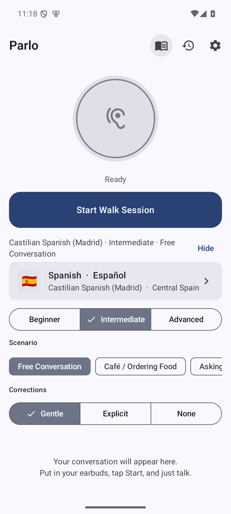
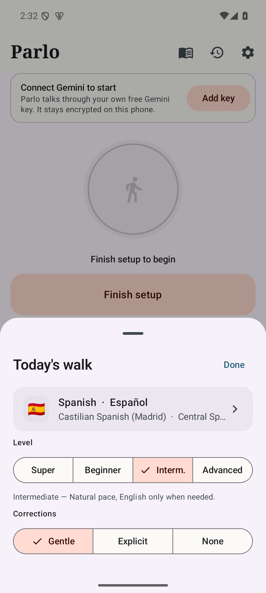
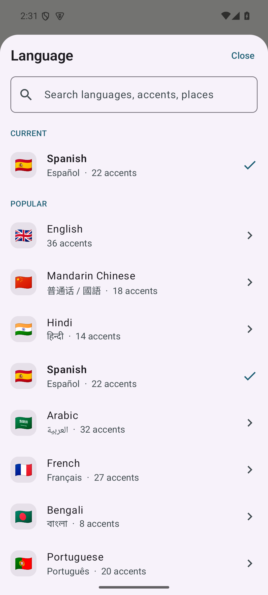
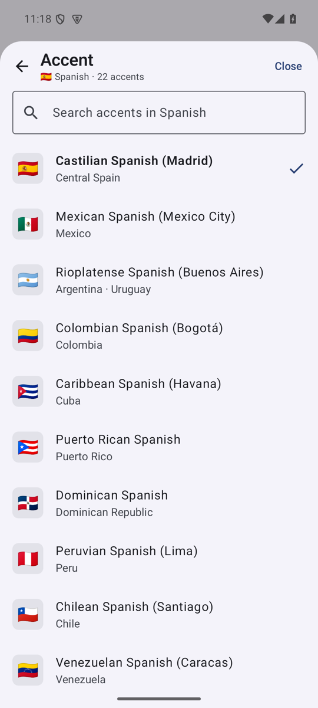
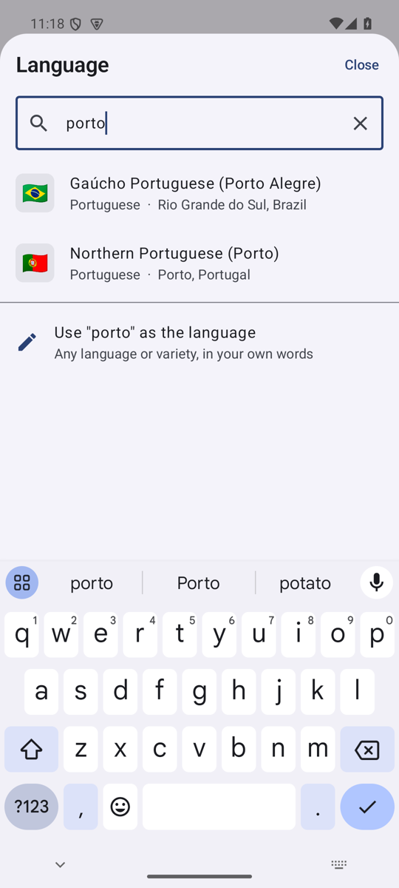
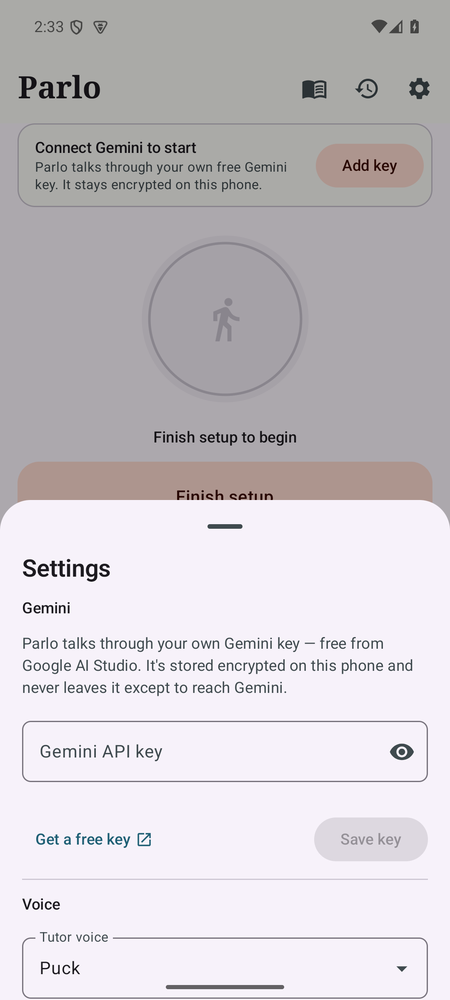
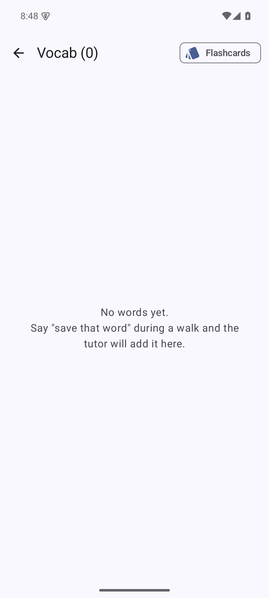
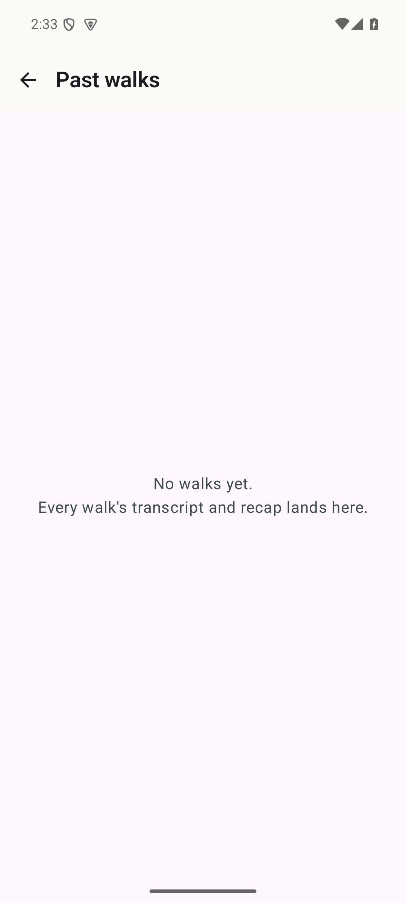

# Parlo

A hands-free, real-time voice language tutor for Android. Put your phone in your pocket, put earbuds in, go for a walk, and talk with Gemini in the language you're learning.

Native Kotlin + Jetpack Compose (Material 3), Gemini Live API over WebSockets. Single user, no accounts, no backend.

## Screenshots

| Main screen (setup not finished) | “Today’s walk” sheet | Language picker | Accent picker | Search (languages, accents, places) |
| --- | --- | --- | --- | --- |
|  |  |  |  |  |

| Settings (key, voice; model under Advanced) | Vocabulary (auto-captured suggestions on top) | Past walks |
| --- | --- | --- |
|  |  |  |

*Captured on an API 35 emulator with no API key configured; until a key is saved and a Live model is found the main button reads **Finish setup** and opens Settings.*

## Features

- **Live voice conversation** with the Gemini Live API (bidirectional audio streaming over WebSocket)
- **Hands-free walking mode**: foreground service with microphone type, notification controls (mute / end), MediaSession headset button support, audio focus, earcons for state changes
- **Bluetooth / wired earbud routing** with mid-session route changes
- **Barge-in**: interrupt the tutor at any time; playback flushes instantly
- **137+ languages, 800+ regional accents**: a built-in catalog (`LanguageCatalog.kt`) covering every region — Europe, East/Southeast Asia, South Asia, Middle East & Central Asia, Africa, the Americas, Oceania — each language with its major regional accents/dialects (e.g. English × 36, Arabic × 32, French × 27, Spanish × 22). Picked through a searchable bottom sheet: language first (Popular + by region, native names, flags), then accent; search matches language names, native names, accent names and places ("porto", "Québec", "粤语"). Anything not in the catalog can still be typed in as a custom language or accent
- **Language-first home**: “Which language today?” with one-tap switching between your saved languages and **Add language** for the full searchable catalog. No fixed language suggestions: the home adapts whether you practise one language or juggle several. Each language restores its own accent, level, topic and correction preferences; voice/model remain global.
- **Tutor-led conversation**: after an answer, repetition or explanation, Parlo supplies the next concrete question, phrase or role-play cue in the same reply rather than stopping at praise or waiting for “continue”. It still leaves thinking time and respects pauses/stopping; Just chat remains conversational, not a forced lesson.
- **Adjustable encouragement** in Settings: five positions from **Matter-of-fact** to **Very encouraging**, defaulting to **Low-key**. Always adult-to-adult, even for beginners. The global preference persists across languages and backups, applies live without a model reconnect, and changes tone—not difficulty or correction frequency. You can also say “less praise” or “be more encouraging”.
- **Continuing learning journeys**: explicit per-language goals, dated teaching checkpoints with transcript sources, older-history retrieval, returning-learner openings, and a journal where you can inspect or exclude remembered walks.
- **Focused home layout**: a compact, labelled language switcher, one **Today’s walk** card, **Guided practice / Just chat**, and a persistent bottom Start action. Accent, level and corrections live in **Walk settings**. Controls stack for large text/narrow screens, and content clears the measured Start bar rather than relying on a fixed spacer.
- **First-walk activation**: choose a language, connect Gemini, then start from a pinned action once ready. Network retries use the saved key; empty-clipboard feedback is visible. Declining optional permissions does not repeatedly gate a microphone-enabled walk.
- **Level / correction style** segmented pickers in Walk settings, plus quick-switch chips of recent combos
- **Voice-driven switching**: say "let's switch to Portuguese" and the tutor calls `switch_language` mid-session
- **Vocabulary**: say "save that word" and the tutor calls `save_vocab`; tap saved words on Home to inspect meanings/examples, with removal as an explicit action and Undo. Review in a list or flashcard mode. Flashcards prompt target-language production from a translation, save explicit recall ratings, and schedule practice at 1/3/7/14/30/60-day intervals. Same-day repetitions don't advance the stage; this is a self-rating, not a proficiency score.
- **Automatic vocab capture** — no need to ask:
  - *In-session*: the tutor has a silent `note_vocab` tool it calls whenever you show a gap (ask what a word means, ask how to say something, stall, answer in English, get corrected) or introduces a genuinely useful new word. Nothing is spoken; the word lands in Vocabulary as a **Suggested** entry with the reason ("You asked what it means", "Tutor corrected you", …).
  - *After the session*: bounded, language-separated transcript tails are sent to Gemini `generateContent` (JSON mode) to mine words you didn't know or the tutor introduced, skipping anything already in your list. Sessions with fewer than two learner turns are skipped. Runs in the background after the recap; you can also re-run it from a session's history page (✨).
  - Suggested entries sit in their own tray at the top of Vocabulary — Keep / Skip individually or all at once, with Undo. Kept words join the normal list and flashcards.
- **Session history** with full transcript and spoken end-of-session recap (a snackbar offers **Skip** while the recap is being written)
- **Automatic model discovery**: lists models advertising `bidiGenerateContent`, prefers newer conversational Live generations, and lets you override it under Settings → Advanced
- **Resilience**: session resumption handles, exponential-backoff reconnect, connectivity monitoring, fresh-session fallback with teaching checkpoints and recent-transcript context. Finalized turns are written in order outside the service lifecycle; process-start recovery marks unfinished walks interrupted using the last persisted timestamp, not the next launch time.
- **Durable consolidation**: WorkManager checkpoints original transcript windows during/after walks and backfills older history, retrying network/model failures without advancing the source cursor. You can start another walk before analysis finishes.
- **Encrypted backup/restore**: Your journey → Protect your progress (also accessible from the welcome screen). Password-encrypted, user-selected files contain all languages, transcripts, vocabulary, review schedules and goals, never the Gemini key.
- **Encrypted API key storage** via `EncryptedSharedPreferences` (Android Keystore)

## Requirements

- Android 8.0 (API 26) or newer; targets API 35
- JDK 17
- Android SDK Platform 35 and Build-Tools 35.0.0
- A Gemini API key from [Google AI Studio](https://aistudio.google.com/apikey)

## Build & install

Run these from `android/parlo` in the [jonaylor.com monorepo](https://github.com/jonaylor89/jonaylor.com) (or `pnpm android:parlo:build` from the root).

```bash
# point Gradle at your SDK (or set ANDROID_HOME)
echo "sdk.dir=$HOME/Android/Sdk" > local.properties

./gradlew :app:assembleDebug
adb install -r app/build/outputs/apk/debug/app-debug.apk
```

Or open the project in Android Studio (Ladybug or newer) and press Run.

Lint: `./gradlew :app:lintDebug`

## Developer / beta app (side-by-side)

Use the **dev** build for local testing on a phone that already has Parlo installed:

```bash
# from android/parlo, with JDK 17 and the Android SDK configured
./gradlew :app:assembleDev
adb install -r app/build/outputs/apk/dev/app-dev.apk
adb shell am start -n com.parlo.app.dev/com.parlo.app.MainActivity
```

- **Parlo Dev** uses application ID `com.parlo.app.dev`, a coral **DEV** badge on both adaptive and legacy launcher icons, and a `-dev` version suffix.
- The welcome screen explicitly labels it a developer build; Settings shows its version, package ID and build type. Service actions and the startup provider are application-scoped.
- Conversations, vocabulary, settings, Android Keystore credentials, widgets and permissions are separate from regular Parlo. Add a Gemini key to the dev app; it does not read or modify the installed app's data.
- `install -r` updates the dev app in place on subsequent local builds. Keep the same local debug keystore to preserve update compatibility; never commit it. `assembleDebug` and `assembleRelease` retain the existing `com.parlo.app` identity, so CI downloads do not unexpectedly become developer builds.
- Run `./gradlew :app:testDebugUnitTest :app:testDevUnitTest :app:lintDebug :app:lintDev :app:assembleDebug :app:assembleDev` to validate both identities. Launcher assets are committed; regenerate after changing the original art with `python3 scripts/generate-dev-icons.py` (Pillow required only for regeneration).

## Tests

None of the tests need a Gemini API key or network access.

```bash
# JVM unit + integration tests (~10 s)
./gradlew :app:testDebugUnitTest

# Instrumented tests: needs a connected device or running emulator
./gradlew :app:connectedDebugAndroidTest
```

| Suite | Where | What it covers |
| --- | --- | --- |
| `GeminiLiveClientIntegrationTest` | `app/src/test` | Drives the real `GeminiLiveClient` over OkHttp against an in-process fake of the Live WebSocket endpoint (`MockWebServer`): setup handshake and `?key=` auth, `setupComplete` gating, PCM `realtimeInput`, `clientContent`, `toolResponse`, decoding of audio / transcripts / tool calls / cancellations / `interrupted` / `turnComplete`, resumption-handle tracking, `goAway` reconnect that resumes with the handle, fallback to a fresh session when the server rejects the handle, fatal `403` → `InvalidApiKey` with no retry, and exponential backoff after a transient drop. |
| `LiveModelDiscoveryTest` | `app/src/test` | `/models` pagination, `bidiGenerateContent` filtering, ranking (newer conversational Live generations first), API-key error surfacing. |
| `MessagesTest` | `app/src/test` | Exact JSON shape of every client message and tolerant parsing of server messages (unknown fields ignored). |
| `LanguageCatalogTest` | `app/src/test` | Catalog breadth and integrity (every language has accents, unique names), case-insensitive / native-name lookup, search ranking, default config points at a real entry. |
| `PromptBuilderTest`, `ToolHandlerTest`, `GeminiApiTest` | `app/src/test` | System prompt contents per language/dialect/level/scenario/correction style; `save_vocab` / `note_vocab` / `switch_language` declarations, execution and responses (silent suggestion, dedupe, promotion of a suggestion by an explicit save); error classification. |
| `VocabMinerTest` | `app/src/test` | Post-session transcript mining against a `MockWebServer` fake of `generateContent`: request shape (JSON mode, schema, transcript, known-word exclusions), model fallback on 404, fenced/malformed output, dedupe and cap, no request when the learner never spoke. |
| `ParloDatabaseTest`, `ParloDatabaseMigrationTest` | `app/src/androidTest` | Room DAOs on-device: session/turn ordering and cascade delete, recap persistence, empty-session cleanup, vocab grouping, suggestion find/keep/dismiss, `minedAt`; schema auto-migration 1 → 2 keeps existing vocab as kept manual entries. |
| `MainScreenSmokeTest`, `VocabScreenTest` | `app/src/androidTest` | Launches `MainActivity`, checks the pickers render, drives the language picker (search → accent selection, custom accent entry), that Start without a key opens Settings, and that Vocab / History are reachable. Renders the Vocab screen against the real store and drives the Suggested tray (keep one, dismiss one, keep all). |

What is *not* covered automatically: a real Gemini Live session (audio quality, model behaviour, actual resumption handles). That needs a key and a phone with earbuds; see [First run](#first-run).

## First run

1. Open Parlo and tap the gear icon.
2. Paste your Gemini API key and tap **Save**. It is stored encrypted on-device and never leaves the phone except in requests to `generativelanguage.googleapis.com`.
3. Tap **Refresh** under *Model* to discover Live-capable models. The highest-ranked conversational Live model is picked automatically; type a model name to override.
4. Pick a voice — all 30 Gemini prebuilt voices, grouped Female / Male with their character (e.g. "Sulafat · Warm", "Charon · Informative"). Tap any voice to hear it greet you in your current language and accent (a short Gemini TTS call on your key, cached per voice).
5. Back on the main screen tap the walk card to choose language, dialect, level, and correction style, then tap **Start Walk Session**.

Parlo will ask for **microphone**, **notification** (Android 13+), and **Bluetooth** (Android 12+) permissions the first time you start a session.

## Talking to the tutor

The tutor speaks first and keeps turns short. Things you can say at any time (in either language):

- "Repeat that slowly"
- "What does ___ mean?" / "How do I say ___?"
- "Correct me more" / "Stop correcting me"
- "Less praise" / "Be more encouraging" → saves the coaching tone for all languages
- "Save that word" → stored to Vocabulary (words you struggle with are also captured silently — see *Automatic vocab capture*)
- "Let's switch to Italian" / "Make it easier" → switches language / level live

Changing language, dialect, level, or correction style in the UI during a session sends a text turn to the tutor. Changing voice or model reconnects with session resumption so context is kept. Voice-driven changes are saved and used for the next walk too.

The first-walk interview keeps the native-accent instructions active throughout. When language, accent and level are confirmed, the profile tool returns the current pronunciation/level guidance to hand off to normal conversation without injecting an interrupting user turn. English explanations must not anglicise the target-language pronunciation.

### Conversation/audio acceptance check (real device)

Use earbuds and then repeat on the phone speaker, with a real key:

1. Start the first walk, choose a non-English regional accent, and finish the interview. Check native pronunciation during the level check and after handoff.
2. Ask for an English explanation, then return to the target language. Check the accent hasn't shifted to English.
3. Change language/accent by voice, end the walk, and start another without restarting the app. Check the selection survives.
4. Interrupt Parlo mid-sentence, including around a phrase-card/vocabulary save. Old speech should stop promptly; the next response and speaking indicator should recover immediately.
5. Pause to think mid-sentence and mute/unmute mid-utterance. Check for premature replies or stalls. Compare end-of-speech → first audible response and interruption → silence across several exchanges; don't tune the silence window below natural learner pauses just to improve the latency number.
6. Refresh models in Automatic mode and check the selected generation; verify an explicit override still works.

## Project layout

```
app/src/main/java/com/parlo/app/
  ParloApp.kt              Application + manual DI container
  MainActivity.kt
  model/                   SessionConfig, LiveSessionState, enums
  data/                    Room DB (sessions, turns, vocab), Settings (encrypted + DataStore), model discovery
  gemini/                  GeminiApi (URLs/version), Messages (wire types), GeminiLiveClient (WebSocket),
                           PromptBuilder (system prompt + tools), ToolHandler
  audio/                   MicrophoneStreamer, AudioPlayer, AudioRouteManager, Earcons
  service/                 LiveSessionService (foreground service, MediaSession, reconnect, recap)
  ui/                      Compose screens: main, settings, vocab, history; MainViewModel; theme; nav
```

## Durable learning and memory

A model connection is temporary; Room is the source of truth. Walks are chapters in a continuing relationship. The tutor reconnects to prior practice, naturally retrieves a little older material, introduces a small challenge and tries it in a changed context. **Just chat** explicitly disables the lesson agenda without deleting the relationship; **Continue my plan** restores it.

- Schema v4 auto-migrates existing sessions/vocabulary. Older turns inherit their session's final language; earlier language switches in legacy transcripts cannot be reconstructed reliably. New turns carry their target-language segment explicitly.
- `LearningRepository` assembles bounded context: the explicit goal, four recent and up to two older teaching checkpoints, six recent excerpts, and up to six vocabulary items due for review. Observations distinguish prompted from independent production; they are not permanent ability grades.
- `MemoryAnalyzer` summarizes original windows of at most 20 turns / roughly 24,000 characters, with per-turn input caps. The full original transcript remains stored. Checkpoints retain session/turn references. They are never recursively compressed from previous summaries.
- `recall_history` searches original transcripts and checkpoint text in the current language using a literal short phrase, returning up to six dated excerpts. This is local phrase retrieval, not semantic search; the tutor must try another wording or admit a missing memory rather than invent one.
- WorkManager queues a checkpoint every twelve finalized conversational turns and at the end of a walk. Startup/key changes drain older unprocessed history in bounded batches. Successful batches continue immediately; only failures incur retry backoff. Background analysis sends relevant transcript windows to Gemini and uses your API quota.
- Excluding a walk transactionally disables future retrieval/backfill and removes its derived checkpoints, including an in-flight checkpoint. Deleting a walk cascades checkpoints and turns. Saved vocabulary remains in your list but words sourced only from excluded/deleted walks are not automatically supplied to the tutor. Exclusion takes effect for subsequent conversations; a running model cannot unhear already-sent data.
- Backup files use AES-256-GCM with fresh salt/IV and PBKDF2-HMAC-SHA256 (210,000 iterations). The password must be at least twelve characters and cannot be recovered. Restore authenticates the complete archive before transactionally replacing learning data; credentials stay device-local. Do not restore during a walk. Archives have a 32 MiB uncompressed safety limit. Backups are manual: uninstall/device loss without an exported backup still loses local data.

Regression tests cover database reopening, v3 migration, interrupted recovery, multilingual isolation, bounded/idempotent compaction, failed-analysis retry, literal history search, exclusion during an in-flight request, cascade deletion, per-language preferences, review scheduling, backup round trips, wrong-password/tampered archives and one-tap language selection. Robolectric renders the language selector in `app/build/uiaudit/40_language_journeys.png`. The optional real-Gemini audit tests require `GEMINI_API_KEY`; a physical phone/earbuds are still needed to assess actual audio and teaching behavior.

## Gemini Live details

- Endpoint: `wss://generativelanguage.googleapis.com/ws/google.ai.generativelanguage.v1beta.GenerativeService.BidiGenerateContent?key=…`
  (API version is centralised in `GeminiApi.API_VERSION`)
- Input: 16 kHz mono 16-bit PCM, ~30 ms chunks, base64 in `realtimeInput.audio`
- Output: 24 kHz mono 16-bit PCM played via `AudioTrack` with a jitter buffer
- Setup enables `AUDIO` response modality, input/output transcription, session resumption, sliding-window context compression, and tutor tools.
- Automatic speech detection uses a 60 ms pre-speech buffer and 600 ms silence window, with barge-in enabled. The mic remains open while Parlo speaks. Muting or losing audio focus sends `audioStreamEnd` so pending speech doesn't stall.
- Tools execute in order outside the audio-event collector. Cancellation and reconnects discard pending tool responses. On known async-capable families (2.5 native audio and 3.8 Live), `note_vocab`, `show_phrase`, and `update_walk` are non-blocking with silent responses; profile/language changes and explicit actions remain blocking. Other models retain the sequential protocol.
- Automatic discovery ranks model generations before legacy naming bonuses, including cached results. The resolved automatic model isn't persisted as an override. Existing saved overrides are preserved: use **Settings → Advanced → Back to automatic** to resume automatic selection.
- Vocabulary mining and durable teaching checkpoints use non-Live `POST /v1beta/models/{model}:generateContent` calls with JSON output (tries `gemini-2.5-flash`, then `gemini-2.0-flash`, then `gemini-flash-latest`). Input is bounded and language-scoped; longer histories are processed incrementally.

## Releases

[`android-parlo.yml`](../../.github/workflows/android-parlo.yml) runs the unit tests and lint and builds a debug APK for every pull request touching `android/parlo`. Pushes to `main` also publish a GitHub Release tagged `parlo-v<versionName>-build.<runNumber>`; https://downloads.jonaylor.com/parlo.apk always points at the newest one. The APK uses the standard debug signing key.

## Website

[`apps/parlo`](../../apps/parlo) is the Astro landing page at https://parlo.jonaylor.com. From the repository root:

```bash
pnpm install
pnpm --filter parlo-site dev
pnpm --filter parlo-site build
```

## Privacy

Transcripts, vocabulary, teaching checkpoints, goals and settings live in the app's private local storage. Android automatic backups remain disabled; you can explicitly export/restore a password-encrypted learning archive. Network traffic goes to Google's Gemini API using your key: Live audio/transcription, model discovery, voice previews, bounded transcript windows for teaching checkpoints, and post-walk vocabulary review. Older history is also sent for checkpoint backfill. You can exclude a walk from future tutor memory in its history detail or your learning journal. Exported archives never include API credentials.
