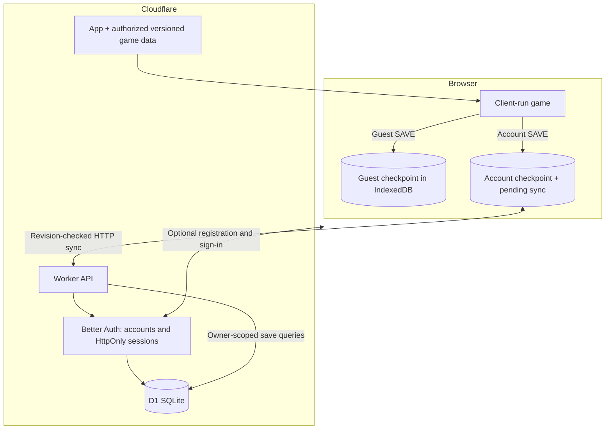

# Workers + D1 + Better Auth

## Scope and status

The app now uses **Cloudflare Workers, D1 (SQLite), and Better Auth**. The earlier backend
implementation and dependency have been removed. There is no parent/child-profile model,
player-to-player trading, link battle implementation, or anonymous cloud-account creation.

**Play and SAVE work as a guest.** Registration/sign-in are optional, suggested after the first
successful guest SAVE in a visit. Accounts add cloud backup, history and cross-device play.
The monorepo app is `apps/pokemon-yellow`. Its only production target is
**https://pokemon-yellow.jonaylor.com**; there is no staging environment. Workers.dev,
version preview URLs and automatic preview builds are disabled. The ignored old
Cloudflare/family draft was not applied. See [PRODUCTION.md](PRODUCTION.md) for the
live deployment verification record and remaining operational responsibilities.

## Architecture



The Worker serves `/api/auth/*` through Better Auth and `/api/save` plus `/api/save/history`
through application handlers. The frontend/API share an origin; no browser API key or auth
secret is needed. D1 is accessible only through the Worker binding, not a public SQL endpoint.

Better Auth is **self-hosted authentication**, not an external managed auth provider.
Cloudflare manages compute/database infrastructure; we own configuration, email delivery,
auth-library updates, abuse protection and operational monitoring.

## Local quick start (no Docker or cloud login)

Requirements: Node **22.13+** (24 recommended), pnpm **10.32.1**, and a modern browser with WebGL,
IndexedDB and Web Locks. Start from the repository root:

```sh
pnpm install --frozen-lockfile
# Download the pinned release; no ROM required.
pnpm --filter pokemon-yellow assets:fetch
pnpm --filter pokemon-yellow dev
```

`pnpm --filter pokemon-yellow dev` applies migrations to **local D1 only**, then starts:

- Game: **http://localhost:5173**
- Local Worker/D1: **http://localhost:8787**
- Development email inbox: **http://localhost:5173/__dev/mail**

Use `localhost` consistently, not a mix of `localhost` and `127.0.0.1`: cookies and trusted
origins are host-specific. Vite proxies `/api` and `/__dev` to the Worker. Verification/reset
emails appear in the local inbox; no external email service is contacted.

Play immediately. After SAVE, choose Not now or open optional sign-in. Create an account,
open the verification email, sign in, and explicitly choose whether to import guest progress.
A second browser profile/incognito context simulates another device.

If a port is occupied, use `pnpm --filter pokemon-yellow dev --port 5174 --worker-port 8788` (or
`pnpm --filter pokemon-yellow preview --port 8788`). The origin/proxy configuration follows those ports.

Local D1 persists under ignored `.wrangler/state/local/`. Stopping/restarting the development
command retains accounts and saves. To reset **disposable local backend data**, stop the
servers, remove that directory and rerun the command. Browser IndexedDB is separate and is
not erased; account journals from the discarded database will remain until explicitly cleared.

For the built production frontend with the same local backend:

```sh
pnpm --filter pokemon-yellow build
pnpm --filter pokemon-yellow preview
# Game/API: http://localhost:8787
# Inbox:    http://localhost:8787/__dev/mail
```

Preview uses the local mail transport and local D1, not a deployed production backend.
Vite dev mode cannot cache its entire development module graph offline: test offline reopening
against `preview` or the production browser QA below. Already-open dev tabs can still save offline.

On this machine the shell Node wrappers are broken. Use the explicit Node binary with the
`node_modules/tsx/dist/cli.mjs`, `typescript/bin/tsc`, `vitest/vitest.mjs`, or `vite/bin/vite.js`
entry points. The local orchestration/test harness uses `process.execPath` for child processes.

## Authentication and email

- Better Auth email/password, minimum 12 characters; verification required for account sessions.
- Same-origin HttpOnly, SameSite=Lax cookies; Secure in production. Passwords use Better Auth's
  password hashing, not application-written cryptography. Password reset revokes other sessions.
- Database-backed sessions, without cookie-cache authorization delays. Session duration is
  seven days, with the library's configured refresh behavior.
- Better Auth's origin/CSRF checks remain enabled. The Worker additionally requires the exact
  configured Origin on mutating API requests; no wildcard CORS is enabled.
- Database-backed auth rate limiting uses the trusted Cloudflare client-IP header. Development
  has higher endpoint limits to exercise flows; production retains the library's stricter rules.
- Daily scheduled cleanup removes expired auth records and day-old limiter/inbox records,
  not game checkpoints. This is separate from account deletion.

Production email currently uses a small Postmark HTTP transport in `worker/mail.ts`. Configure a
verified sender `me@jonaylor.com` and `POSTMARK_SERVER_TOKEN`; `POSTMARK_MESSAGE_STREAM`
defaults to `outbound`. Credentials are Worker secrets, never build-time VITE variables.
Email jobs use the Worker execution context's `waitUntil`; failures log a generic delivery error
without passwords or reset links. Configure alerting and verify actual inbox delivery.

Local mail is stored in local D1 and exposed only when **both** `LOCAL_DEV=true` and the request
and configured app hosts are loopback. A public deployment with local configuration is rejected
by the auth factory. Never deploy `--env local`; production also rejects the checked-in local secret.

Better Auth's Drizzle adapter uses `transaction: false` because D1 does not support interactive
transactions. This affects the library's multi-step auth operations: for example, a failed
password-reset database write may consume the token/revoke sessions before the password update.
Request a new link on failure. Do not claim those library operations are atomic. Game-save
atomicity is implemented separately below and does not rely on that adapter behavior.

## Guest saves, ownership and sync

- Guest: raw checkpoint at `guest:slot1`, mirrored to a guest-scoped localStorage key. No cloud
  identity or API write is created. Old unscoped `slot1` data is copied once; the original remains.
- Account: `account:USER_ID:slot1` journal in IndexedDB contains checkpoint, base revision,
  pending request UUID and recovery copies. A local checkpoint commits before the game says saved.
- Every existing game-save call site (START, PC box changes, Hall of Fame) uses the installed
  guest/account backend. Guest prompting is nonblocking and dismissible.
- The server derives ownership from the verified Better Auth session. Every query is scoped to
  that ID. The `X-Game-Account` header is only an account-switch consistency guard: it must match
  the session, and cannot authorize access to another account.
- Uploads carry an expected revision and stable request UUID. The database either commits or
  returns the current checkpoint as a conflict. Retrying an acknowledged write returns its
  original acknowledgement; an old ACK cannot clear a newer queued local SAVE.
- A cleared slot is a revisioned tombstone, preventing silent resurrection by an offline device.
- One page-lifetime Web Lock per guest/account slot coordinates same-browser tabs. Separate
  devices can play concurrently; explicit checkpoint selection resolves divergence.

### Atomic D1 save writes

D1 migrations create the current-save, version-history and request-receipt tables. A **single
INSERT into `game_save_requests`** is the write transaction boundary. Its SQLite triggers:

1. Check the current revision and per-account save rate.
2. Update/create the current checkpoint.
3. Append the historical checkpoint and retain the latest 20.
4. Retain the request receipt and prune to the latest 120.

All of these commit or roll back together; there is no unsafe read-then-write gap or attempted
`BEGIN/COMMIT` across separate D1 calls. Concurrent retries re-read the receipt after a rejected
insert. Payloads stay as original JSON text to preserve the integrity checksum's property order.

Limits: 1 MiB per checkpoint, 120 accepted saves/minute/account, 20 cloud checkpoints,
120 request receipts and 10 local account alternatives. Budget for the retained payload copies,
D1 query/storage limits, authentication costs and email volume. These are not unlimited quotas.

### Import, conflicts and account changes

Sign-in never automatically transfers guest progress. The import dialog compares guest/account
checkpoints, including trainer, play time, location and save time. A decision is remembered for
that exact guest checkpoint/account pair; a new guest save can be offered later. Import leaves
the guest copy intact and uses the same revision protocol as normal saves.

Conflict selection restores a **saved checkpoint**, not unsaved in-memory play or a merge.
The alternative is retained for recovery. Restoring history also restarts from a checkpoint.

Sign-out returns to the separate guest slot; it neither copies account progress there nor
removes the account's pending queue. Another account cannot upload that queue. HttpOnly cookie
revocation needs a connection: offline sign-out is not reported as successful; reconnect and retry.
Other browsers/devices remain signed in when signing out the current session.

Previously implemented account journals are not automatically reassigned to new Better Auth IDs.
There was no deployed backend migration. Legacy files remain untouched; recover/export any
historical test journals deliberately rather than assigning them to unrelated new accounts.

## Authorized game-data delivery and offline support

The operator has stated they hold the necessary rights. This repository grants none.
Confirm authorization covers the audience, territories, extracted data/graphics/text/audio,
distribution and offline caching. Guest/public access and private authentication are not licenses.

`prepare:assets` extracts the supported operator ROM into ignored
`public/game-data/{manifest.json,bundle-SHA256.json,NOTICE.txt}`. The raw ROM is never published.
The manifest/bundle schema is **57**. For reproducible builds, `assets:fetch` downloads the
public GitHub release pinned in `assets.release.json`, validates the manifest, bundle size/hash,
and matching distribution notice before writing files. `deploy` checks the built copy too.
To publish a new data release, prepare the authorized assets with the actual notice, upload
all three files to a versioned release, then update the checked-in pin. No ROM is uploaded. Browser startup automatically downloads/verifies/caches data;
a missing or invalid cache never produces a ROM picker. The local QA notice is a fixture, not a
production distribution notice. All these asset files remain excluded from VCS.

Static URLs are public. This is not DRM and cannot remotely revoke an offline asset copy.
Assets may live on the same Worker static host or a CDN. For a separate CDN, set
`VITE_GAME_MANIFEST_URL`, enable appropriate GET CORS and update `public/_headers` CSP connect-src.
Prefer immutable release-specific manifests and retain old versions for older app shells.

The production service worker caches only the app shell, never API/auth responses. It caches
canonical `/` HTML (Cloudflare redirects `/index.html`) and returns a fresh navigation Response
so browser redirect restrictions do not break reloads. Updates wait until old tabs close.
Game data lives separately in IndexedDB. The ACCOUNT panel reports when offline setup is ready.

Initial asset download and account creation/sign-in require internet. Downloaded guests and
previously signed-in accounts can reopen offline; expired sessions keep account progress local
until the original account signs in again. Local browser access is not a security boundary:
saves are unencrypted and storage can be cleared/evicted. Export checkpoints and keep cloud backups.

## Production deployment (one environment)

- Worker: `pokemon-yellow`; D1: `pokemon-yellow`, using the real binding in app `wrangler.jsonc`.
- Origin/custom domain: `https://pokemon-yellow.jonaylor.com`.
- Runtime secrets: `BETTER_AUTH_SECRET` (strong random 32+ characters), `POSTMARK_SERVER_TOKEN`.
- Public runtime variables: `APP_ORIGIN`, `EMAIL_FROM=me@jonaylor.com`, `POSTMARK_MESSAGE_STREAM=outbound`.
- Do not enable `LOCAL_DEV` remotely or deploy `--env local`. Local routes are explicitly empty
  so the production custom domain cannot rewrite localhost Origin headers in the dev proxy.

Cloudflare Workers Builds watches `jonaylor89/jonaylor.com` branch `main`, using the repository
root and pnpm workspace. Watch paths cover this app, the root package/lock/workspace files,
`.npmrc` and Turbo config. Preview builds are disabled. The production pipeline is:

```sh
pnpm --filter pokemon-yellow assets:fetch
pnpm --filter pokemon-yellow test
pnpm --filter pokemon-yellow build
pnpm --filter pokemon-yellow db:migrate:production
pnpm --filter pokemon-yellow run deploy
```

Remote migrations are reviewed, forward-only changes and run before publishing new code;
keep migrations backward-compatible with the previous deployment. D1 migration tracking makes
retries safe. Builds contain no ROM and need no Postmark credential; runtime secrets remain
in the Worker. The repository-wide GitHub workflow also builds the app and runs its tests.
ROM-dependent gameplay tests require the operator ROM and are skipped in ordinary CI.

For secret updates, from the monorepo root with the correct Cloudflare login:

```sh
pnpm --filter pokemon-yellow exec wrangler secret put BETTER_AUTH_SECRET --env ""
pnpm --filter pokemon-yellow exec wrangler secret put POSTMARK_SERVER_TOKEN --env ""
```

The Postmark server token is shared with Hub. Rotate/update both services together; changing
only one service will interrupt its verification/reset delivery. Never put credentials in Git,
VITE variables, command arguments, logs or chat. `dev`, `preview`, tests and local browser QA
always use local D1; they never run the remote commands above. No migration from the discarded
external backend is needed.

Before public launch, also verify:
- Worker CPU/memory budgets for password hashing/concurrent logins; do not assume free-tier CPU
  limits suffice. Exercise real Cloudflare D1 limits, database backups/restore and alerts.
- Auth upgrades, external email deliverability, abuse/CAPTCHA policy and billing/storage quotas.
- Privacy/age/consent requirements and account-deletion procedures. Self-service deletion is not
  implemented; admin deletion of the `user` row cascades sessions/accounts/cloud saves/history.
  Copies on offline devices remain until cleared.
- Security headers/CSP, actual iOS/Android offline lifecycle, storage eviction and phone GPU behavior.
- Dependency audit findings: existing build/test/browser tooling still has reported advisories;
  some are also classified under Better Auth's optional testing peer dependencies. They are not
  imported by the deployed Worker, but still need a tooling-security follow-up. No clean audit is claimed.

The game remains client-run. The backend validates save structure, ownership and transactions,
not legitimate Pokémon progression. Checksums detect corruption, not cheating. Trading remains
out of scope and would require a new ownership/integrity design.

## Validation

```sh
pnpm --filter pokemon-yellow test
pnpm --filter pokemon-yellow build
pnpm --filter pokemon-yellow qa:cloud  # requires downloaded data and installed Chrome
```

The API integration suite starts an isolated local D1/Worker, registers synthetic test accounts,
uses real verification/reset delivery and cookies, tests Origin/ownership/session boundaries,
concurrent saves, retries and deletion, then stops/removes that test backend. No Docker needed.

Browser QA builds the production frontend and starts another isolated real backend. It drives
intro/name menus and START → SAVE using actual keys, reads displayed glyph pixels (no engine
state injection/private globals), and tests guest/account saves on two browser profiles,
offline reload, conflict/recovery, explicit imports, account isolation, reset/logout and tab locks.
It does not intercept API requests or write synthetic IndexedDB saves. Default mode creates
only local accounts. Physical devices remain a separate check.

### Opt-in live production browser QA

With the Postmark token loaded securely into the process environment, explicitly set
`PYW_PRODUCTION_ORIGIN=https://pokemon-yellow.jonaylor.com` and run `qa:cloud`. This runs the
same real-input suite on production, including verification/reset emails, two-device cloud
saves, offline reopening, conflict recovery and account isolation. It accepts no other origin.
It creates unique `pokemon-qa-UUID@blackhole.postmarkapp.com` users and reads only those exact
recipients through Postmark; it never lists or reads real Hub/user mail. No mail is sent to
real recipients. Production uses random initial passwords.

The exact disposable email addresses are recorded in ignored `extracted/production-qa-users.json`.
After success or failure, remove **only those exact users** via an authenticated admin D1
parameterized `DELETE FROM "user" WHERE email = ?`. Foreign keys cascade their sessions, auth
accounts, saves and history. Do not delete unrelated users or reset the production database.
Never expose the development inbox or weaken production verification/rate limits to run QA.
