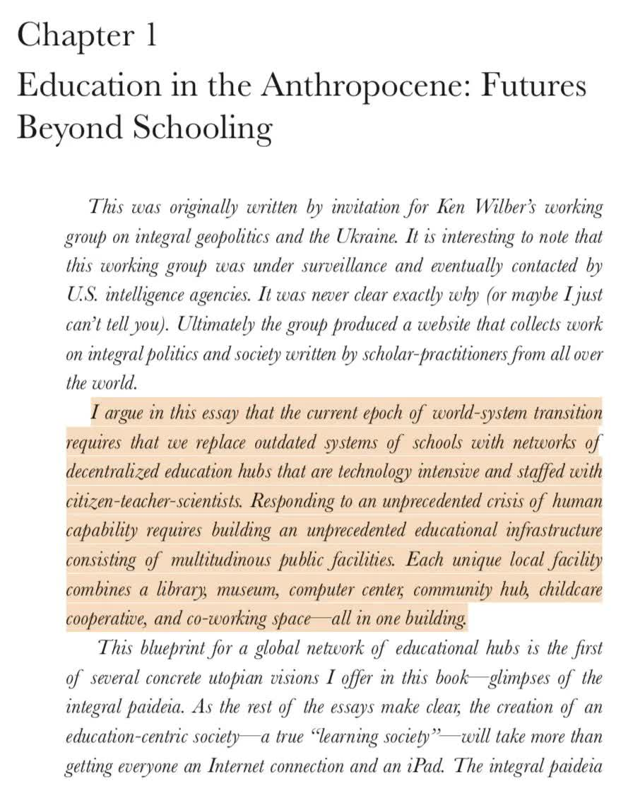
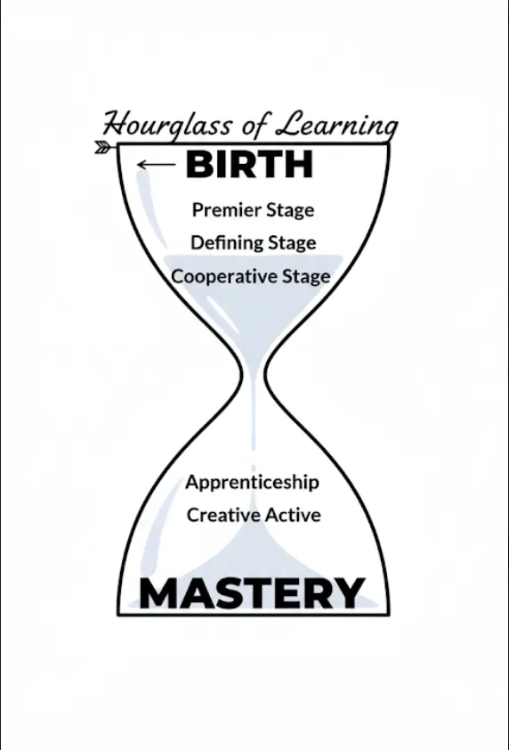

Robert Greene’s [*Mastery*](https://www.amazon.com/Mastery-Robert-Greene/dp/014312417X) presents an interesting framework for how individuals rise to excellence: through apprenticeship, creative experimentation, and, ultimately, intuitive mastery. His work captures the trajectory of adults who have already chosen their field and committed to years of disciplined effort. When I first read the book, I kept thinking about what comes before that. How does someone reach the threshold of apprenticeship? What prepares them to undertake the demanding path toward mastery?

I first read the book in high school. During high school and early college, I jotted down some very unstructured thoughts in a notebook that I just happened to find recently, which is what got me to write this post ✨. Those notes outline an alternative framework for public education that generalizes some of the ideas of *Mastery*, but starts from birth.

The framework centers on three developmental stages: **Premier** (childhood), **Defining** (adolescence), and **Cooperative** (young adulthood). Across all three, the emphasis is on **creativity** and **communication**, with mastery as a longer-term direction rather than a separate school subject.

What follows is a lightly edited and reorganized version of those notes from almost a decade ago, with an example to make the ideas more concrete. It’s a sketch, not a complete proposal for an educational system.

## The three stages at a glance

The movement is from broad exploration toward focused, practical participation. The ages are approximate, not deadlines for choosing a field or becoming a professional.

| Stage | When | Purpose | Learning | Guidance |
| :--- | :--- | :--- | :--- | :--- |
| **Premier** | Childhood, roughly 0–12 | Explore broadly | Exposure to many topics | Parents and guardians |
| **Defining** | Adolescence, roughly 12–16 | Develop an interest | Deeper study of a general field | The wider community |
| **Cooperative** | Around 16 into young adulthood | Contribute through practice | Hands-on work and thought experiments | Professional mentors and peers |

### Premier: explore broadly

Parents and guardians are present for a majority of learning. Children encounter a variety of topics, with the hope that one or a few will catch their interest. The point is exposure, not early specialization.

### Defining: find a direction

Students pick a general field to explore more deeply. Parents remain important, but the wider community becomes a greater part of the student’s education and guidance.

### Cooperative: learn through contribution

Learning is split between hands-on work with the community (similar to internships and co-ops) and individual and group thought experiments. Professional mentors help students integrate into working life in their chosen field.

## Example Kid/Student

Take a kid who's interested in going to space. This is an illustration of what the process could look like.

<ol className="not-prose my-8 space-y-6 border-l-2 border-default pl-6">
  <li>
    
Premier

    
How do we go to space?

    
Read about space, visit a science museum, and explore how astronauts get there with a parent or guardian. Rockets are one interest among many things to discover.

  </li>
  <li>
    
Defining

    
How do we launch a rocket, and what's the math behind it?

    
Explore model rocketry and learn about thrust, gravity, and drag. Use math to predict a rocket's flight, then compare those predictions with results from supervised launches.

  </li>
  <li>
    
Cooperative

    
How do we put on launches together?

    
Work alongside experienced members of a rocketry society to build and launch model rockets. Take responsibility for part of a team project, participate in safety reviews, understand the chemistry/physics deeply and share what each launch teaches the group.

  </li>
</ol>

The same interest becomes a way to practice both priorities: **creativity**, by asking questions and considering possible solutions, and **communication**, by listening, reading, discussing, and sharing the results.

## Two priorities throughout

### Creativity: developing new ideas

**Conceptual understanding** would be emphasized over memorization of isolated facts and equations. The goal is to understand how something works well enough to ask useful questions and contribute ideas. Facts and equations still have a role; they support understanding rather than stand in for it.

**Thought experiments** would have dedicated time, both individually and in groups. Students would have opportunities to ask “what if?”, imagine alternatives, and work through the implications of their ideas.

### Communication: sharing and understanding ideas

Education should help students improve their ability to share information and understand one another. These skills would be practiced alongside the subject matter, not treated as something separate from it.

| Skill | What students practice |
| :--- | :--- |
| **Speaking** | Presenting ideas publicly and conversing with others |
| **Listening** | Understanding speakers, taking useful notes, and engaging in conversation |
| **Reading** | Understanding material and developing strategies for different kinds of texts |
| **Writing** | Conveying information clearly in longer work, letters, and messages |

In the rocketry example, that might mean reading technical documentation, listening to a mentor’s feedback, keeping a flight log, and presenting launch results to the society. Communication is part of doing the work.

## The community’s role

Education and society are directly related. This framework depends on more interconnected communities, not just a different curriculum inside the same institutions.

In my original notes, I wrote that there would be no “teachers” or “administrators” because everyone would be a teacher and the community as a whole would administer the education of its youth. The central idea is that responsibility for learning would be shared more widely.

<figure className="not-prose my-8 border-y border-default py-6">
  
The learner ↔ a community of learning

  <dl className="grid gap-6 sm:grid-cols-2">
    

      <dt className="font-bold">Family and guardians</dt>
      <dd className="mt-1 text-text-secondary">Provide support and explore alongside the learner.</dd>
    

    

      <dt className="font-bold">Peers</dt>
      <dd className="mt-1 text-text-secondary">Exchange ideas and work through questions together.</dd>
    

    

      <dt className="font-bold">Professional mentors</dt>
      <dd className="mt-1 text-text-secondary">Guide practice and connect learning to working life.</dd>
    

    

      <dt className="font-bold">Local organizations</dt>
      <dd className="mt-1 text-text-secondary">Offer real projects and opportunities to contribute.</dd>
    

  </dl>
  <figcaption className="mt-6 text-sm text-text-secondary">The emphasis shifts across the stages; the relationships don’t simply disappear.</figcaption>
</figure>

That leaves significant questions unanswered: who coordinates this work, who remains accountable, and how does every student get access to support and mentors? A diagram of a connected community isn’t a solution to those problems. The competitive atmosphere and bureaucratic nature of society today would make the system I imagined difficult to realize without broader changes.

A related passage in *Education in the Anthropocene: Futures Beyond Schooling* describes a physical setting for community-based learning:

> Each unique local facility combines a library, museum, computer center, community hub, childcare cooperative, and co-working space—all in one building.

View the source excerpt

## From exploration toward mastery

My old “hourglass of learning” drawing tried to connect these early stages to Greene’s path toward mastery.

*The original sketch. The narrowing can be read as finding a focus; the widening as the possibilities for creative contribution that deeper practice opens up. It’s a metaphor, not a measure of ability or a fixed timetable.*

In simpler terms:

> **Explore broadly → Find a direction → Contribute with others → Deepen practice → Create new possibilities**

Premier, Defining, and Cooperative are the stages from my notes. Apprenticeship, creative experimentation, and mastery are the ideas I was responding to in Greene’s book. The cooperative stage is meant to help bridge early exploration and the more sustained practice that follows, rather than imply that meaningful work only begins after education ends. 
